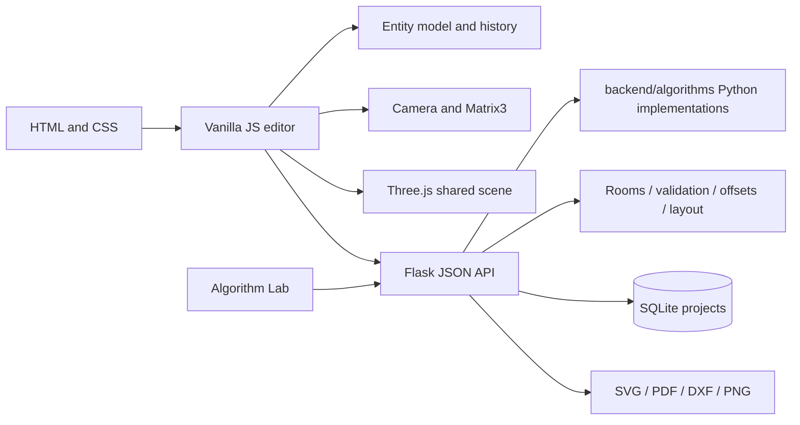

# Meridian Studio Floor Plan CAD

Meridian Studio is a browser-based 2D/3D floor-plan editor for a Computer Graphics course project. It uses a Flask/SQLite backend, a vanilla JavaScript ES-module canvas frontend, and a Three.js 3D model view. Geometry coordinates are stored in centimeters; the status bar displays meters.

## Run

```sh
python3 -m venv .venv
source .venv/bin/activate
pip install -r requirements.txt
python app.py
```

Open <http://localhost:5000>. The browser app supports grid drawing, pan/zoom, object snaps, undo/redo, browser autosave, SQLite projects, sample plans, room metrics, and exports. Run tests with `pytest` after installing requirements.

## Features

- Draw and edit walls, lines, rectangles, circles, doors, windows, furniture primitives, dimensions, and text labels.
- Switch between the 2D drafting canvas and a Three.js 3D model view. The compact live 3D inset and expanded view share the same entities; moving an object in 3D updates its 2D coordinates and saved plan.
- Select, move, delete, duplicate, rotate, mirror, lock, and edit entity thickness/layer/label.
- Grid and object snaps, Shift-ortho drawing, cursor-anchored zoom, pan, metric coordinates, and numeric commands (`5000`, `@3000<90`; lengths are millimeters).
- Local JSON autosave, server-backed projects, three samples, JSON import/download, print view, and SVG/PDF/DXF/PNG exports.
- Python room detection and area/perimeter labels, plan validation, wall offsets, dimensions, and grid-based auto-layout API.
- Python DDA, Bresenham, midpoint circle, scanline fill, line clipping, polygon clipping, homogeneous transforms, and geometry predicates.
- Algorithm Lab at `/lab` computes all algorithm results through Python API endpoints and uses the browser only for canvas rendering.

The 3D view loads Three.js as an ES module from jsDelivr and therefore needs an internet connection. The 2D editor remains available if the external 3D module cannot load.

## API

All JSON request bodies are validated. Project payload shape: `{ "title": "Plan", "units": "cm", "entities": [{ "type": "wall", "points": [{"x":0,"y":0},{"x":400,"y":0}], "thickness": 12 }] }`.

| Method | Endpoint | Purpose |
| --- | --- | --- |
| GET | `/api/health` | Service status |
| GET | `/api/projects` | List saved projects |
| POST | `/api/projects` | Create a project |
| GET | `/api/projects/{id}` | Load a project |
| PUT | `/api/projects/{id}` | Replace a project document |
| DELETE | `/api/projects/{id}` | Delete a project |
| GET | `/api/samples` | List the three built-in plans |
| POST | `/api/geometry/rooms` | Detect closed wall loops and return area, perimeter, centroid |
| POST | `/api/geometry/validate` | Report wall overlaps, corner gaps, and openings off walls |
| POST | `/api/geometry/offset` | Return mitered left/right polyline offsets |
| POST | `/api/geometry/dimensions` | Generate metric dimensions for every wall segment |
| POST | `/api/geometry/auto-layout` | Pack requested rectangular rooms into a simple grid |
| POST | `/api/export/{format}` | Export as `svg`, `pdf`, `dxf`, or `png` |
| POST | `/api/lab/bresenham` | Bresenham pixels and decision trace |
| POST | `/api/lab/dda` | DDA raster pixels |
| POST | `/api/lab/midpoint-circle` | Midpoint circle decision trace |
| POST | `/api/lab/cohen-sutherland` | Region-code line clipping trace |
| POST | `/api/lab/liang-barsky` | Parametric line clipping result |
| POST | `/api/lab/sutherland-hodgman` | Convex polygon clipping result |
| POST | `/api/lab/scanline` | Even-odd horizontal fill spans |
| POST | `/api/lab/matrix` | 3×3 transform and transformed point |

The API is same-origin by default; localhost development origins on ports 5000/5001 receive CORS headers. Request bodies are limited to 8 MB.

## Shortcuts

| Action | Shortcut |
| --- | --- |
| Select/move | `V` / `M` |
| Wall, line, rectangle, circle | `W`, `L`, `R`, `C` |
| Dimension, text | `D`, `T` |
| Undo / redo | `Ctrl` or `Cmd` + `Z` / `Y` |
| Delete selection | `Delete` |
| Ortho while drawing | `Shift` |
| Grid snap | `G` |
| Rasterization mode | `F8` |
| Pan | `Space` + drag or middle mouse |
| Cancel | `Esc` |

## Architecture



## Computer Graphics Mapping

All implementations are in `backend/algorithms/`.

| Concept | Python implementation |
| --- | --- |
| DDA and Bresenham | `backend/algorithms/raster.py`: `dda_line`, `bresenham_line`, `bresenham_trace` |
| Midpoint circle | `backend/algorithms/raster.py`: `midpoint_circle`, `midpoint_circle_trace` |
| Even-odd scanline fill | `backend/algorithms/raster.py`: `scanline_fill` |
| 3×3 homogeneous transforms | `backend/algorithms/transforms.py`: `Matrix3` |
| World/screen transform and zoom | `backend/algorithms/transforms.py`: `Matrix3.transform_point`, `inverse` |
| Cohen-Sutherland / Liang-Barsky | `backend/algorithms/clipping.py`: `cohen_sutherland_trace`, `liang_barsky_clip` |
| Sutherland-Hodgman | `backend/algorithms/clipping.py`: `sutherland_hodgman_clip` |
| Hit-testing and geometry | `backend/algorithms/geometry.py`: distance, ray cast, intersection, polygon metrics |
| Pixel plotting | `backend/exporters/png_exporter.py`: export paths and `backend/algorithms/raster.py` pixels |
| Room area and centroid | `backend/services/room_detection.py`: `detect_rooms` |
| Shared 2D/3D entities | `backend/models/projects.py`: validated serialized entity documents |

## Tests and Reports

- `backend/tests/`: `pytest` coverage for graphics algorithms, geometry services, REST behavior, and export signatures.
- [Theory and implementation report](docs/theory-report.md) records equations, complexity, and program locations.
- [Five-minute demo and viva script](docs/demo-script.md) gives a presentation walkthrough.

## Current Scope Notes

This project emphasizes a runnable course-project core. The current UI has straight segment walls and drag-defined primitives; advanced CAD workflows such as arbitrary multi-vertex polyline editing, trim/extend, group/ungroup, full dimension styles, and a dedicated auto-layout dialog are not yet exposed in the UI. Their core geometry/API extension points are kept separate for follow-on work.